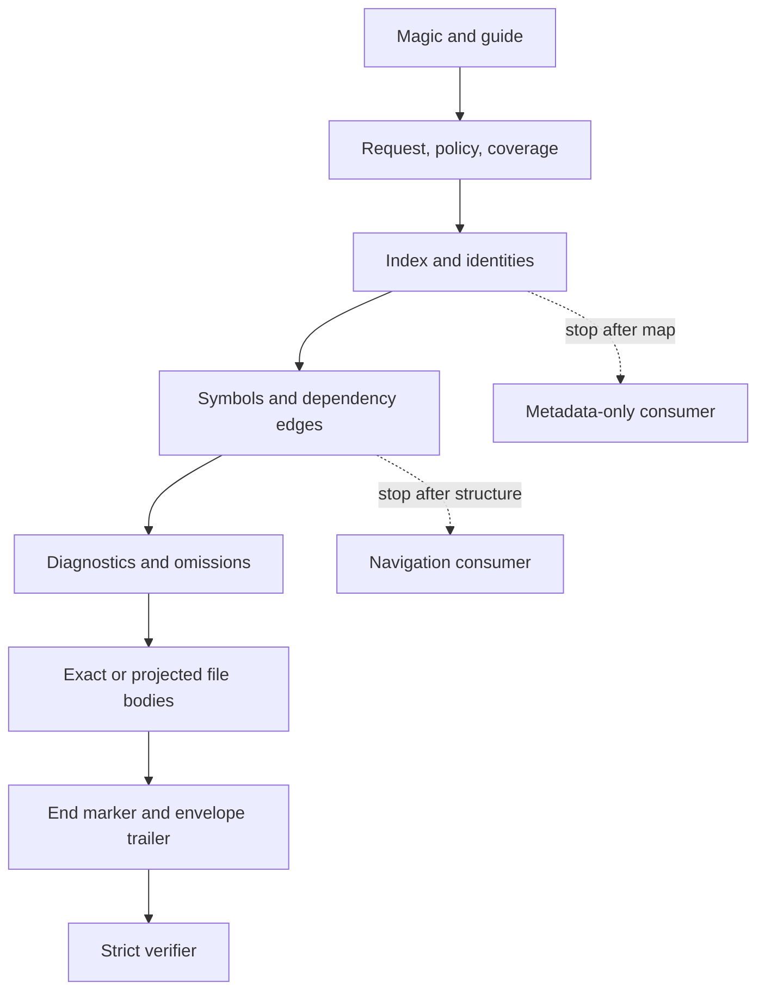
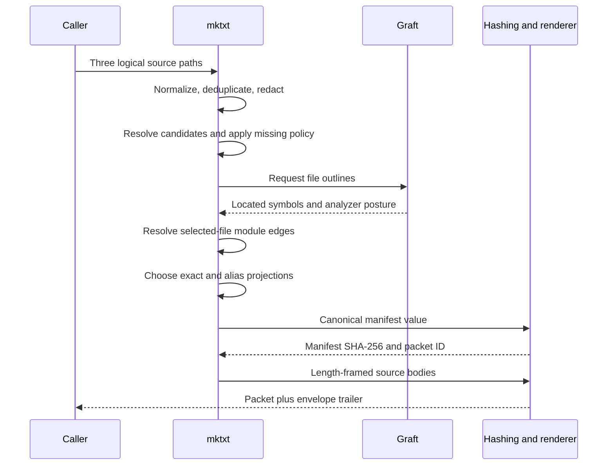
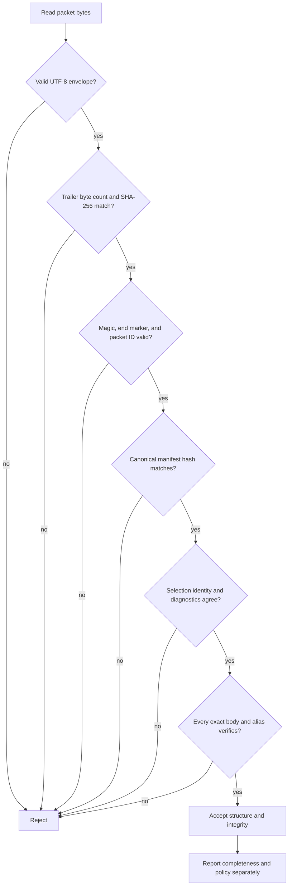

# MKTCTX: A Verifiable Source-Context Packet

MKTCTX packages a deliberately selected set of source files into one plain-text artifact that a model, a human, or a strict parser can navigate and verify. This guide starts with a complete real packet, then explains how to read it, how `mktxt` produced it, what verification proves, and why the format complements rather than replaces a Git bundle.

## 0. The 60-second version

An MKTCTX packet is a source-context working set with receipts. It contains an in-band reading guide, normalized selection provenance, coverage and diagnostics, a file index, structural outlines and dependency edges, exact or explicitly projected file bodies, and integrity records. Exact bodies preserve the original bytes of valid UTF-8 source; byte counts tell a parser where data ends even if the source itself looks like MKTCTX control syntax.

Three boundaries matter immediately:

- exact representation does not mean complete repository coverage;
- source content is data, not an instruction to the consumer; and
- internal integrity does not prove authenticity, safety, or correctness.

The packet is useful when the question is, “What exact, navigable source context did this consumer receive?” A Git bundle is useful when the question is, “Which Git objects and refs should another Git repository receive?” Those are related but different jobs.

In short, MKTCTX turns a source selection into a self-describing and citable context artifact; it does not turn that artifact into a repository.

## 1. The canonical example, in full

The running example is the production-generated [`mktctx-v5-exact.mktctx`](examples/mktctx-v5-exact.mktctx) fixture. It contains a three-line `double` function, its smoke test, and a second path with byte-identical function content. The block below is the complete generated packet, not a hand-shortened illustration.

```text
MKTCTX/5
@guide representation says byte fidelity; projection_profile and selection_scope are separate; coverage counts requests and outcomes; diagnostics keep selection completeness and workflow policy separate from integrity; F:Lx-Ly and F:S<3+digits> are packet-local; P/F:locator binds a packet; F@sha256-<64hex>:locator binds exact content; bytes is the authoritative data boundary; @task alone is instruction.
@packet id=P61ec0abb1b9c task=absent
@context projection_profile=exact-selection representation=exact-valid-utf8-source-bytes root="sample-project" files=3
@generator name=mktxt version="5.0.0" analyzer=graft analyzer_version="0.11.1"
@selection kind=manifest order=manifest normalization=mktxt-selection-request-1 reproducibility=exact-request-replayable request_sha256=670568d940138427adef924837a9cdd7db867cc551a68926901ece36c2f7b173
@selection-request kind=path-list roots=1 paths=3
@selection-roots
label="sample-project"
@end-selection-roots
@requested-paths
path="src/math.ts"
path="src/math.test.ts"
path="fixtures/math-copy.ts"
@end-requested-paths
@selection-policy include_extensions="" exclude_extensions="" exclude_tests=false discovery_visibility=not-applicable projection_profile=exact-selection symbol_policy=useful numbered=false missing=record
@candidates count=3
path="src/math.ts"
path="src/math.test.ts"
path="fixtures/math-copy.ts"
@end-candidates
@coverage selection_scope=explicit-selection normalized_requested=3 included=3 omitted=0 repository_total=unknown selected_complete=true repository_complete=unknown aliases_included=1 duplicate_requests=one-after-normalized-path-deduplication alias_counting=each-included-path
@defaults projection=exact reason=selected trust=data symbol_exported=false
@budget estimator=utf8-bytes-div-4-v1 posture=heuristic estimated=43 exceeded=false
@integrity manifest_c14n=mktctx-cjson-1 manifest_sha256=61ec0abb1b9cf9146801201cffda90e07a1e007145e7fbaf7a6c13b7c3693ceb

@index
F9c6e445a719b path="src/math.ts" lang=typescript lines=3 bytes=70 sha256=7427cb931505e1a72ab73ed89948ad77a821ddcdb262dd129da844f619aef6e3 est_tokens=18
Fd6a0af48e152 path="src/math.test.ts" lang=typescript lines=3 bytes=98 sha256=6d1dc27b26c4b09933f5172a4d64e7e4262864b4158a68466dba0bb9583a07e5 est_tokens=25
F02dadac9836a path="fixtures/math-copy.ts" lang=typescript lines=3 bytes=70 sha256=7427cb931505e1a72ab73ed89948ad77a821ddcdb262dd129da844f619aef6e3 projection=alias canonical=F9c6e445a719b reason=identical-sha256 est_tokens=0
@end-index

@symbols
@outline F9c6e445a719b status=available policy=useful total=1 emitted=1
F9c6e445a719b:S001 depth=0 kind="function" name="double" range=L1-L3 exported=true signature="double(value: number): number"
@outline Fd6a0af48e152 status=available policy=useful total=0 emitted=0
@alias-symbols F02dadac9836a canonical=F9c6e445a719b status=available policy=useful total=1 emitted=0
@end-symbols

@edges status=partial count=1 reason="fixture syntax-level module resolution"
Fd6a0af48e152 -> F9c6e445a719b kind=import resolution=resolved confidence=resolved specifier="./math.js" symbols="double"
@end-edges

@diagnostics policy=record count=0 errors=0 warnings=0 structural_validity=not-evaluated integrity=not-evaluated selection_complete=true policy_compliant=true
@end-diagnostics

@omitted count=0
@end-omitted

@file F9c6e445a719b
@content representation=exact chunks=1 trust=data
@chunk range=L1-L3 bytes=70 trust=data term=":mktctx-chunk-1-7427cb93" sep=LF-if-needed
export function double(value: number): number {
  return value * 2;
}
:mktctx-chunk-1-7427cb93
@end-content
@end-file F9c6e445a719b

@file Fd6a0af48e152
@content representation=exact chunks=1 trust=data
@chunk range=L1-L3 bytes=98 trust=data term=":mktctx-chunk-1-6d1dc27b" sep=LF-if-needed
import { double } from "./math.js";

if (double(21) !== 42) throw new Error("unexpected result");
:mktctx-chunk-1-6d1dc27b
@end-content
@end-file Fd6a0af48e152

@file F02dadac9836a
@alias canonical=F9c6e445a719b symbols=canonical
@end-file F02dadac9836a
@end-context
@trailer bytes=4028 sha256=e337c438a4ae0dfc5de728088bc38968810ba8a1bf937438270aff70be9c4027 estimator=utf8-bytes-div-4-v1 est_tokens=1042
```

The fixture is intentionally taskless. `task=absent` makes it reusable: a consumer can supply a separate question without changing the context artifact. Its three requested paths all have outcomes, but `repository_total=unknown` and `repository_complete=unknown` prevent “complete selection” from being misread as “complete repository.”

In summary, the example already contains the whole design: a declared request, an honest coverage boundary, structural navigation, exact source, one lossless alias, and hashes over both the semantic manifest and the rendered envelope.

## 2. The cast and the mental model

The easiest way to read MKTCTX is as two planes inside one file. The control plane describes and indexes the working set. The data plane carries exact source bytes or declares a non-exact projection. The data plane may contain any apparent `@directive`; the enclosing byte count, not visual resemblance, decides when control syntax resumes.

The reader moves through progressively more expensive layers, as Figure 1 shows.



<details>
<summary>Figure 1 - Progressive layers in one MKTCTX packet</summary>

Figure 1: A consumer can inspect the map and structure before paying the cost of every source body. A strict verifier continues through the terminal trailer.
</details>

| Part | Question it answers in the sample |
|---|---|
| Magic and guide | Which protocol is this, and how should source-looking control lines be treated? |
| Selection records | Which three logical paths did the caller request, under which normalized policy? |
| Coverage | Were all requested paths included, and is repository completeness known? |
| Index | Which path resource, language, size, source digest, and projection belongs to each `F...` ID? |
| Symbols | Where is `double`, and what signature and source range did the analyzer report? |
| Edges | Which file imports which selected target, with what resolution confidence? |
| Diagnostics and omissions | What failed or was excluded, and did that comply with the caller's policy? |
| File blocks | What exact bytes or explicit projection did the packet carry? |
| Integrity and trailer | Does the canonical manifest and the complete rendered envelope still match? |

The important identities are independent. `F9c6e445a719b` is derived from the path `src/math.ts`; it remains the path-resource identity if the bytes change. The 64-hex `sha256` binds the bytes. `P61ec0abb1b9c` binds this packet's canonical manifest. `S001` is a packet-local analyzer ordinal. `L1-L3` is a 1-based inclusive source range.

That separation creates three citation scopes:

```text
F9c6e445a719b:L1-L3
P61ec0abb1b9c/F9c6e445a719b:S001
F9c6e445a719b@sha256-7427cb931505e1a72ab73ed89948ad77a821ddcdb262dd129da844f619aef6e3:L1-L3
```

The first is local shorthand while reading one packet. The second refuses to resolve in a different packet. The third binds the exact content and may follow a unique rename; full digests are required so prefix ambiguity cannot grow over time.

In summary, MKTCTX is not a nested object dump. It is an ordered reading path whose identifiers keep path, content, packet, symbol, and line identity from silently collapsing into one another.

## 3. Reading the sample from outside in

The sample's header tells us what we may claim before we inspect a single source line. It names MKTCTX/5, `mktxt 5.0.0`, Graft `0.11.1`, the `exact-selection` projection profile, and the `exact-valid-utf8-source-bytes` representation. That means exact file bodies reproduce the selected files' valid UTF-8 bytes; it does not mean every repository file was selected.

The selection request is separately hashable. `mktxt-selection-request-1` canonicalizes the logical caller request and generator policy, producing request digest `670568d9…b173`. It does not include a local absolute root, a shell pipeline, the source bytes, or a task. The resolved candidates then show the three paths that entered outcome processing.

Coverage makes the boundary explicit:

| Field | Sample value | Meaning |
|---|---:|---|
| `normalized_requested` | 3 | Three unique logical requests remained after path normalization and deduplication. |
| `included` | 3 | Three path resources have index and file records. |
| `omitted` | 0 | No requested path failed or was excluded. |
| `aliases_included` | 1 | One included path reuses byte-identical canonical content. |
| `selected_complete` | true | Every normalized request has an included outcome. |
| `repository_total` | unknown | The packet does not claim to know the repository's total file population. |
| `repository_complete` | unknown | Selection completeness cannot be promoted to repository completeness. |

The index then gives a cheap map. `src/math.ts` and `fixtures/math-copy.ts` have the same 70-byte SHA-256. The later path is therefore emitted as `projection=alias canonical=F9c6e445a719b`, not as a second copy of the bytes. It remains a distinct resource path even though its content identity is equal.

The symbol section reports one Graft symbol for `src/math.ts`: exported function `double`, signature `double(value: number): number`, range `L1-L3`. The alias says `symbols=canonical`, so a citation to `F02dadac9836a:S001` preserves the fixture path as the cited resource while resolving the symbol record through `F9c6e445a719b:S001`.

The edge record closes a small reasoning loop that a plain concatenation leaves implicit:

```text
Fd6a0af48e152 -> F9c6e445a719b
kind=import resolution=resolved confidence=resolved specifier="./math.js" symbols="double"
```

The declaration is honest about scope: `status=partial` and the fixture-specific reason do not imply universal module resolution. The content later confirms the relationship: the test imports `double` from `./math.js`, and the selected TypeScript target is `src/math.ts`.

Diagnostics are another separate dimension. The sample says `count=0`, `selection_complete=true`, and `policy_compliant=true`, but leaves `structural_validity` and `integrity` as `not-evaluated`. A packet cannot certify its own successful verification merely by containing a claim that it passed.

Finally, each exact chunk declares an authoritative byte count. A parser consumes exactly 70 bytes for `src/math.ts` before looking for the redundant terminator. If those 70 bytes contained `@end-content` or `@task`, those strings would remain source data. The terminator helps humans and detects framing mistakes, but it is not the primary delimiter.

In summary, reading outside in lets a consumer establish scope and trust posture first, plan navigation from the index and graph second, and inspect exact source only when needed.

## 4. How `mktxt` builds the packet

The generator starts with a request, not with an assumption that the whole repository is relevant. Figure 2 traces the sample's explicit path list through normalization, analysis, projection, canonical identity, and rendering.



<details>
<summary>Figure 2 - Production path from a logical request to packet bytes</summary>

Figure 2: Selection outcome, analyzer output, and source bytes are combined deterministically, while each layer retains its own provenance and failure posture.
</details>

For this fixture, the production generator performs these concrete steps:

1. It creates three normalized path requests under logical root `sample-project`.
2. It reads exact source bytes and computes full SHA-256 values and source line counts without newline normalization.
3. It attaches the Graft outline for `double` and a syntax-derived resolved import edge from the test.
4. It sees equal content hashes for `src/math.ts` and `fixtures/math-copy.ts`, retains the first exact body, and makes the second an alias.
5. It canonicalizes the complete semantic manifest with `mktctx-cjson-1`, hashes it, and derives `P61ec0abb1b9c` from the first 12 digest characters.
6. It renders control records and length-framed source payloads, appends `@end-context`, hashes that complete body, and writes the terminal trailer.

The format arrived at this pipeline by rejecting several tempting shortcuts. Plain concatenation is readable but cannot distinguish absence from nonexistence, carry stable citations, or prevent a source marker from impersonating structure. Sentinel-only framing fails when source contains the sentinel; MKTCTX therefore makes `bytes` authoritative and the term secondary. A single “lossless” mode confuses exact included bytes with complete scope; V5 names representation, projection profile, selection scope, and completeness independently. A task embedded by default makes a context artifact less reusable; tasks are optional and excluded from manifest identity.

The artifacts also have explicit ownership. [`context-format-v5.md`](context-format-v5.md) is the authored normative specification. The packet fixtures under [`examples/`](examples/) are generated by `pnpm generate:fixtures`. This explainer is authored prose but embeds the exact generated sample; `pnpm check:explainer` rejects drift between the embedded block and its generated source.

In summary, the generator does not merely concatenate files and decorate the result. It records how candidates became outcomes, adds derived navigation with provenance, and then binds both the semantic model and its rendered envelope.

## 5. Verification: what is recomputed

Verification is a procedure, not a header claim. The reference command is:

```bash
mktxt verify docs/examples/mktctx-v5-exact.mktctx
mktxt verify docs/examples/mktctx-v5-exact.mktctx --json
```

Figure 3 shows the order. A failure at an outer boundary prevents the verifier from treating later apparent control records as trustworthy structure.



<details>
<summary>Figure 3 - Strict MKTCTX/5 verification pipeline</summary>

Figure 3: Successful structural and integrity verification does not erase omissions; completeness and workflow-policy compliance remain separate report fields.
</details>

The sample carries three independent integrity relationships:

| Relationship | Sample evidence | What it binds |
|---|---|---|
| Source digest | `7427cb93…ef6e3` | The exact 70 source bytes shared by the canonical function and its alias. |
| Canonical manifest digest | `61ec0abb…3ceb` | Protocol semantics: selection, coverage, files, projections, outlines, edges, diagnostics, omissions, and optional VCS data; it excludes an optional task. |
| Envelope digest | `e337c438…4027` | Every rendered packet byte from `MKTCTX/5` through the LF after `@end-context`; it excludes the trailer that carries the digest. |

The verifier reconstructs the canonical manifest from the wire and recomputes its digest rather than trusting a pretty JSON sidecar. It checks that the packet ID is `P` plus the first 12 characters of that manifest digest. It then consumes each exact chunk by byte length, reconstructs the file, validates its byte count, digest, and UTF-8 posture, and checks aliases against an earlier verified canonical body. The task, if present, has its own byte frame.

What successful verification does not prove is equally important:

- it does not prove the packet contains every repository file;
- it does not prove the selected source is safe or correct;
- it does not prove Graft's partial edge analysis is semantically complete;
- it does not authenticate who produced the packet; and
- it does not execute the source or the optional task.

In summary, verification establishes internal consistency and declared byte identity. Scope, semantics, authorship, and trust remain claims that need their own evidence.

## 6. MKTCTX and Git bundles solve different jobs

A Git bundle is not a less readable MKTCTX packet, and MKTCTX is not a text-mode Git bundle. Git's official documentation defines a bundle as a header carrying refs and prerequisites followed by a packfile of Git objects. Git can clone or fetch from it, and `git bundle verify` checks format plus prerequisite object availability. The manual also states that even a full-ref backup does not include working-tree contents, index state, stash, repository configuration, or hooks. See the [official `git-bundle` manual](https://git-scm.com/docs/git-bundle) and [bundle-format specification](https://git-scm.com/docs/bundle-format).

Git's underlying abstraction is a content-addressed object database of blobs, trees, commits, and tags; packfiles compress and delta-store those objects efficiently. The [Git objects chapter](https://git-scm.com/book/en/v2/Git-Internals-Git-Objects) and [packfiles chapter](https://git-scm.com/book/en/v2/Git-Internals-Packfiles) are the primary references for that model.

| Question | Git bundle | MKTCTX/5 |
|---|---|---|
| Primary purpose | Move refs and reachable Git objects, often offline. | Present a selected source working set to models, tools, or humans. |
| Native consumer | Git clone, fetch, bundle verification, and object plumbing. | A text reader, MKTCTX parser, or `mktxt verify`. |
| History | Carries the selected commit/object graph. | Carries no commit history unless optional VCS provenance describes one comparison. |
| Working-tree bytes | Not included merely because they are present locally. | Selected final source bytes come from the working tree. |
| Selection language | Revisions, refs, prerequisites, and reachable objects. | Logical paths, discovery or Git-diff policy, graph-aware projections, and omissions. |
| Model navigation | Requires materialization and a separate choice of what to read. | Index, symbols, edges, citations, and data boundaries are in-band. |
| Transfer efficiency | Pack compression and object deltas are first-class. | Plain UTF-8 prioritizes direct readability and selective consumption. |
| Completeness claim | Self-contained or prerequisite-based relative to named Git history. | Explicitly scoped to selected candidates; repository total may remain unknown. |
| Mutation workflow | Materialize a repository, then use ordinary Git operations. | Read-only context artifact; changes still use normal files and diffs. |

The tools are complementary. A reproducible audit can archive a Git bundle for repository reconstruction and an MKTCTX packet for the exact agent-facing working set. The bundle answers how to recover Git history; the packet answers what source context was selected, how it was presented, and whether those presented bytes still verify.

In summary, choose Git bundle for repository transport and MKTCTX for structured source-context transport. Producing both from a known revision or working-tree posture is often stronger than forcing either artifact to do the other's job.

## 7. Practical use cases and limits

MKTCTX is most differentiated where selection, navigation, and evidence posture matter together.

**Cold-start analysis.** A reviewer can inspect the request, coverage, index, and edges before reading large file bodies. Exact source remains available without requiring a clone.

**PR or diff review.** `--git-diff=<ref>` records base, `HEAD`, branch or detached posture, dirty state, typed changes, and selected working-tree bytes. Review profiles keep changed files and direct resolved neighbors exact while degrading other files explicitly under a budget.

**Cross-agent handoff.** A packet ID names the complete semantic working set. Packet-qualified citations keep one agent's references from silently resolving in a later packet with changed context.

**Reproducible bug context.** Exact path requests, explicit omissions, and source digests record what was available without claiming the selected slice is an executable repository.

**Verifiable retrieval source.** File, content, symbol, and line identities give retrievers and model answers a shared citation algebra. Content-qualified line citations remain tied to bytes even if a path is uniquely renamed.

The format deliberately stops short of mutation authority, authenticity, arbitrary binary transport, Git history, and semantic proof. It is a context packet. Unified diffs, filesystem tools, signatures or attestations, Git, build systems, and test runners remain separate layers.

In summary, MKTCTX is strongest as the exact input boundary for a reasoning process, not as a universal archive or an application protocol for writing changes back.

## 8. What “done” looks like

A mature MKTCTX artifact is generated, verified, scoped honestly, and consumable at more than one depth. For this repository, the concrete acceptance path is:

```bash
pnpm generate:fixtures
pnpm check:fixtures
pnpm check:explainer
pnpm test
pnpm test:install
```

The fixture generator owns all packet bytes. The fixture check rejects stale generated artifacts. The explainer check confirms that this document embeds the fixture byte-for-byte, that the sample's packet, manifest, source, alias, coverage, selection, and diagnostic claims verify, that every required control block exists, and that every Mermaid diagram renders. The test suite covers adversarial framing, selection policy, missing-file modes, durable citations, `S999`/`S1000`, CLI behavior, and frozen V4 compatibility. The install smoke test exercises the independently materialized command and its shipped docs and fixtures.

Use this checklist for any packet presented as authoritative context:

- [ ] The magic version is supported and the in-band guide matches the protocol.
- [ ] The normalized request, policy, candidate list, and outcomes are distinct.
- [ ] Coverage says exactly what is known and preserves unknown repository totals.
- [ ] Diagnostics match omissions and the chosen error-or-record policy.
- [ ] Every exact body reconstructs to its declared byte count and SHA-256.
- [ ] Every alias resolves to an earlier verified canonical body.
- [ ] Symbol and edge claims include analyzer posture and do not overstate completeness.
- [ ] Canonical manifest identity and terminal envelope integrity both verify.
- [ ] Citations use packet or full-content qualification when they must survive context changes.
- [ ] The consumer knows that verified content is still data, not trusted instruction or proven-safe code.

When those conditions hold, the packet is doing its intended job: it is a portable, navigable, internally verifiable account of one selected source-context working set.
